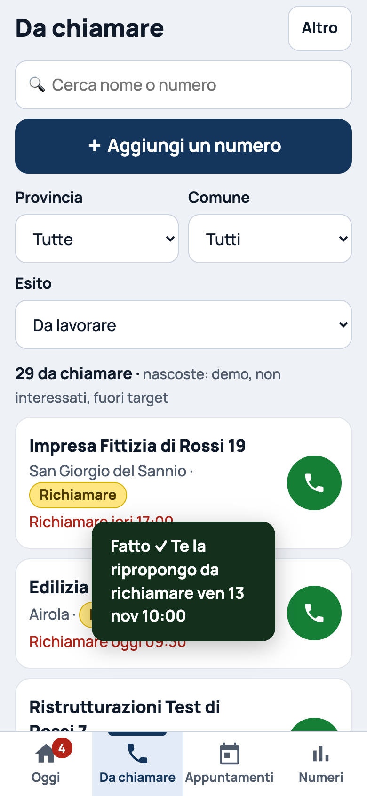
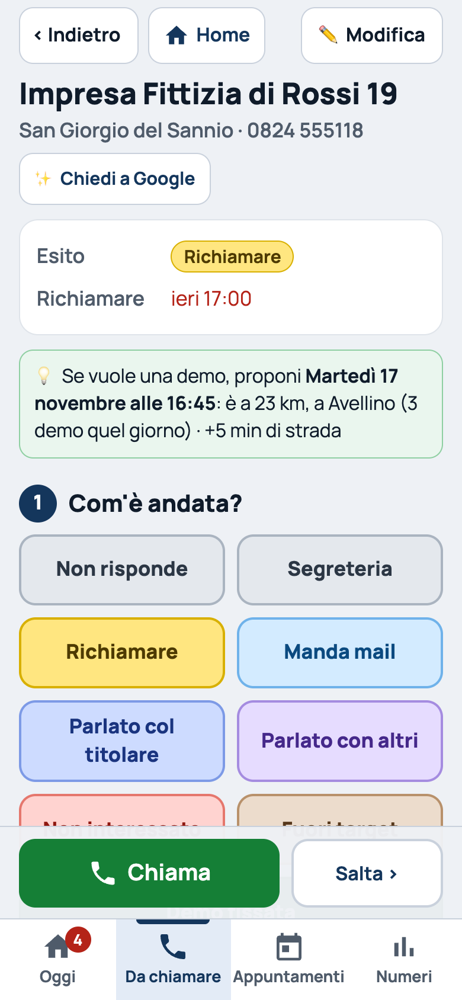
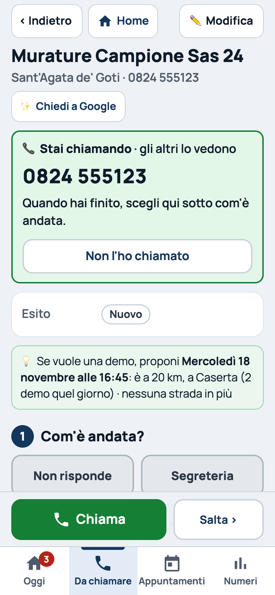
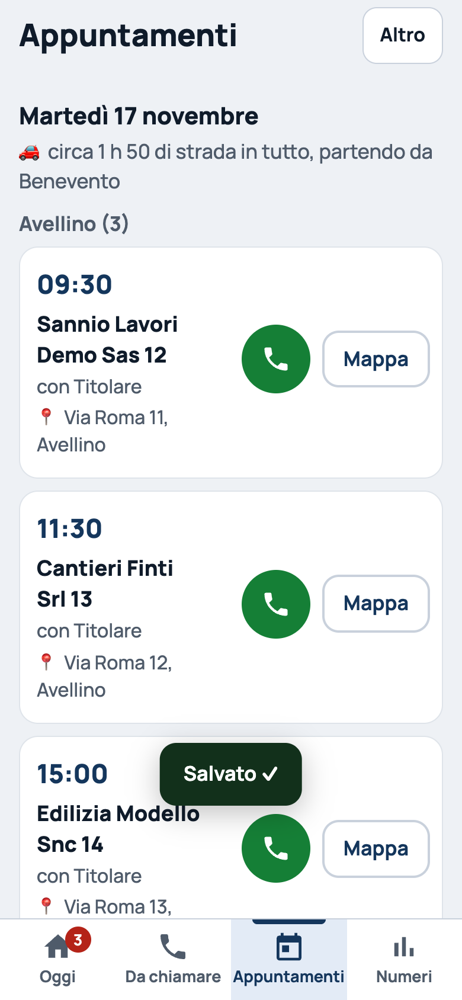

# Chiamate Aedify

App per le cold call di Aedify: chi chiamare, chi sta chiamando adesso, richiami, appuntamenti di Alessandro e numeri della squadra. Si usa dal telefono (e anche dal PC), si installa sulla schermata Home e si aggiorna da sola quando un altro salva qualcosa.

| Da chiamare | Scheda | Sto chiamando | Appuntamenti |
|---|---|---|---|
|  |  |  |  |

Gli screenshot usano solo dati inventati.

---

## Come si usa (in breve)

1. **Oggi** (la prima schermata): cosa fare adesso, in ordine di precedenza. Prima le chiamate fatte senza esito salvato, poi i richiami in ritardo, poi quelli di oggi, poi le mail da inviare e le demo di oggi e domani. Con **Inizia a chiamare** si apre il contatto migliore.
2. **Da chiamare**: filtri per provincia, comune ed esito. Tocca un'azienda → **Chiama** (dal PC: **Sto chiamando**) → scegli com'è andata → **Salva e passa al prossimo**. Oppure **Salta ›** per passare oltre senza cambiare nulla.
3. Quando premi **Chiama**, gli altri vedono subito "📞 In chiamata: Benedetto". Se chiami e non salvi, resta scritto "esito non salvato" e te lo ricorda **Oggi**.
4. **Mail da inviare**: **Scrivi la mail** la apre già compilata (il testo si cambia in `js/config.js`, sezione `EMAIL`); **Mail inviata ✓** la toglie e la ripropone da richiamare dopo 3 giorni.
5. **＋ Aggiungi un numero**: scrivi o incolla il numero; se c'è già ti dice chi l'ha chiamato; se è nuovo cerca da solo nome e comune su Pagine Gialle.
6. **✨ Chiedi a Google** nella scheda: apre la modalità IA di Google per sapere cosa fa l'azienda e che fatturato ha.
7. Quando l'azienda vuole una demo, l'app consiglia **giorno e ora** in base agli appuntamenti già fissati, perché Alessandro guidi il meno possibile.
8. **Altro** (in alto a destra): importare una lista, scaricare tutto in Excel, uscire.

---

## Messa online: passo per passo

Servono circa 30 minuti. Non serve programmare. Fai i passi **in quest'ordine**.

### Passo 1 – Creare i 3 utenti (Supabase)

1. Vai su [supabase.com](https://supabase.com), entra e apri il progetto.
2. Menu a sinistra: **Authentication** → **Users** → pulsante **Add user** → **Create new user**.
3. Scrivi email e password della persona e lascia spuntato **Auto Confirm User**. Poi **Create user**.
4. Ripeti per Benedetto, Luca e Alessandro. Le password le scegliete voi: non scriverle da nessuna parte nel codice.

**Importante – chiudi le iscrizioni:** **Authentication** → **Sign In / Providers** (in alcune versioni si chiama "Providers" o "Settings") → disattiva **Allow new users to sign up** → **Save**. Così nessun altro può crearsi un account.

### Passo 2 – Creare le tabelle (script SQL)

1. Menu a sinistra: **SQL Editor** → **New query**.
2. Apri il file [`supabase/schema.sql`](supabase/schema.sql), copia **tutto** il contenuto e incollalo.
3. Premi **Run**. Deve comparire "Success. No rows returned".

Lo script crea le tabelle, i permessi (solo per chi ha fatto l'accesso, mai per gli anonimi), le regole di sicurezza e gli aggiornamenti in tempo reale. Inoltre **abilita gli utenti creati al passo 1**: per questo va eseguito dopo.

> Se più avanti aggiungi un quarto utente, crealo come al passo 1, poi nel SQL Editor esegui solo l'ultima riga dello script:
> `insert into public.membri (user_id) select id from auth.users on conflict do nothing;`

### Passo 3 – Ricerca automatica del numero (facoltativo, ma comodo)

Serve per compilare da solo nome e comune quando aggiungi un numero.

1. Menu a sinistra: **Edge Functions** → **Deploy a new function** → **Via Editor**.
2. Come nome scrivi esattamente: `cerca-numero`
3. Cancella il codice di esempio, apri il file [`supabase/cerca-numero.ts`](supabase/cerca-numero.ts), copia tutto e incollalo.
4. Lascia attivo **Verify JWT** (così la possono usare solo gli utenti collegati). Premi **Deploy function**.

Se salti questo passo l'app funziona lo stesso: nome e comune si scrivono a mano, oppure si usa **Incolla dati copiati**.
Nota: la ricerca legge le pagine pubbliche di Pagine Gialle e Pagine Bianche. Se un giorno cambiano il loro sito, la ricerca smette di trovare risultati (l'app lo dice e si va avanti a mano).

### Passo 4 – L'app è già online

È pubblicata su GitHub Pages, nel repository `bennoolivaa/chiamate`:
**https://bennoolivaa.github.io/chiamate/**

Ogni modifica caricata sul repository va online da sola in un paio di minuti.

### Passo 5 – Ultimo ritocco su Supabase

**Authentication** → **URL Configuration** → **Site URL**: `https://bennoolivaa.github.io/chiamate/` → **Save**.

### Passo 6 – Sul telefono

Apri l'indirizzo dell'app, entra con email e password (il telefono propone di ricordarle). Poi:
- **iPhone**: tasto Condividi → **Aggiungi alla schermata Home**.
- **Android**: menu ⋮ → **Installa app** (o "Aggiungi a schermata Home").

Comparirà l'icona **Chiamate Aedify**.

---

## Impostazioni dei giri di Alessandro

Nel file [`js/config.js`](js/config.js), sezione `GIRI`, si cambiano: dove dorme (`partenza`), il periodo (`dal`, `al`), gli orari, la pausa pranzo, la durata di una demo, quante demo al giorno al massimo, se lavora il sabato e la domenica.
Su GitHub: apri il file → matita ✏️ → modifica → **Commit changes**. In un paio di minuti l'app si aggiorna.

Come funziona il consiglio: per ogni giorno del periodo e per ogni buco tra due demo già fissate, l'app prova a inserire la nuova demo e calcola quanta strada in più costa, rispettando orari, viaggi, margine tra una demo e l'altra e pausa pranzo. Propone le 3 soluzioni con meno strada.
Le distanze sono stimate dalle coordinate dei comuni (linea d'aria × 1,35, a 55 km/h): vanno bene per scegliere il giorno, non sono un navigatore. I comuni previsti sono quelli di Campania, Molise, Basilicata, Puglia e Lazio.

---

## Provare in locale (con dati finti)

Dal Terminale, nella cartella `chiamate`:

```
python3 -m http.server 8000
```

Poi apri `http://localhost:8000/?demo`: email qualsiasi, password `prova`. I dati sono inventati e restano solo nel browser. Puoi aprire due finestre ed entrare come Benedetto e come Luca per vedere gli aggiornamenti in tempo reale. Per ripartire da zero: `http://localhost:8000/?demo&azzera`.

Test automatici (servono Node.js e Playwright):

```
cd test
npm install
npm test
```

Provano lo script SQL su un Postgres locale (permessi, regole di sicurezza, doppioni), la logica dei giri e l'app nel browser a 390 px, salvando gli screenshot in `screenshot/`.

---

## Struttura

```
index.html            pagina dell'app
stile.css             aspetto
js/config.js          indirizzo Supabase, nomi, esiti, impostazioni dei giri
js/dati.js            lettura/scrittura dei dati e tempo reale
js/app.js             accesso, navigazione, pezzi comuni
js/schermate.js       Da chiamare, scheda, Richiami, Appuntamenti, Numeri
js/altro.js           Aggiungi, Modifica, Importa, Esporta
js/giri.js            consiglio di giorno e ora per le demo
js/utili.js           telefoni, date, file CSV, testo copiato
js/finto-supabase.js  dati finti per la prova in locale
dati/comuni.json      coordinate dei comuni
supabase/schema.sql   tabelle, permessi, sicurezza (passo 2)
supabase/cerca-numero.ts  ricerca del numero (passo 3)
vendor/               Preact e Supabase (copiati qui, niente servizi esterni)
sw.js, manifest.webmanifest, icone/   app installabile sul telefono
```

## Sicurezza

- Nel codice c'è solo la chiave **pubblica** (publishable) di Supabase: è fatta per stare nel browser.
- **Non mettere mai** la chiave *secret* o *service_role* nel codice o su GitHub.
- Senza accesso non si legge né si scrive nulla: i permessi sono dati solo al ruolo `authenticated` e solo agli utenti nella tabella `membri`.
